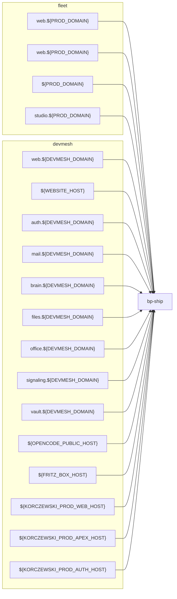

# Domains-Map

<!-- GENERIERT aus docs/agent-guide/registry/domains.yaml — nicht von Hand editieren.
     Neu erzeugen: task domains:map · Pruefen: task domains:check -->

Jeder oeffentlich erreichbare Host, gruppiert nach Cluster und Frontend-Team.

## Funktion x Frontend

| Funktion | Frontend | Hosts | Status |
|---|---|---|---|
| backend | bp-ship | `web.${DEVMESH_DOMAIN}` | live |
| files | bp-ship | `files.${DEVMESH_DOMAIN}` | live |
| frontend | bp-ship | `web.${PROD_DOMAIN}` `web.${PROD_DOMAIN}` `web.${PROD_DOMAIN}` `web.${DEVMESH_DOMAIN}` `${WEBSITE_HOST}` `${KORCZEWSKI_PROD_WEB_HOST}` `${KORCZEWSKI_PROD_APEX_HOST}` | frozen/live |
| mail | bp-ship | `mail.${DEVMESH_DOMAIN}` | live |
| middleware | bp-ship | `auth.${DEVMESH_DOMAIN}` | live |
| office | bp-ship | `office.${DEVMESH_DOMAIN}` | live |
| ops-access | bp-ship | `${OPENCODE_PUBLIC_HOST}` `${FRITZ_BOX_HOST}` | live |
| redirect | bp-ship | `${PROD_DOMAIN}` | live |
| secrets | bp-ship | `vault.${DEVMESH_DOMAIN}` | live |
| signaling | bp-ship | `signaling.${DEVMESH_DOMAIN}` | live |
| sso | bp-ship | `${KORCZEWSKI_PROD_AUTH_HOST}` | live |
| websocket | bp-ship | `studio.${PROD_DOMAIN}` `brain.${DEVMESH_DOMAIN}` | live |

## Entscheidungen (D1-D3)

| Key | Entscheidung |
|---|---|
| D1 | web.mentolder.de (Astro) ist die kanonische oeffentliche Seite; react.mentolder.de ist sekundaer/Redirect. |
| D2 | agent-board ist das kanonische devmesh-Ops-Cockpit; web.devmesh/sdlc sind Tickets/Pipeline. |
| D3 | board.mentolder.de ist Excalidraw/Whiteboard und eigenstaendig gegenueber agent-board/brett. |

### Begruendete Splits im Register

- **`website-mentolder`** (web.${PROD_DOMAIN}) — D1: web.mentolder.de (Astro) ist die kanonische oeffentliche Seite; react.mentolder.de ist sekundaer/Redirect.
- **`website-staging`** (web.${PROD_DOMAIN}) — D1: Staging-Spiegel der kanonischen Astro-Seite; nur QA, kein Index.
- **`apex-korczewski`** (${PROD_DOMAIN}) — D1: Apex leitet auf den kanonischen web-Host weiter.
- **`devmesh-web`** (web.${DEVMESH_DOMAIN}) — D2: agent-board ist das kanonische devmesh-Ops-Cockpit; web.devmesh/sdlc sind Tickets/Pipeline.
- **`devmesh-website-alias`** (${WEBSITE_HOST}) — D2: Kompat-Alias auf denselben Website-Service; kanonisch bleibt web.
- **`devmesh-opencode`** (${OPENCODE_PUBLIC_HOST}) — Ops-Einstieg hinter oauth2-proxy; eigener Host, kein FritzBox-Zugang.
- **`devmesh-fritzbox`** (${FRITZ_BOX_HOST}) — FritzBox-Lokalzugang; eigener Host, kein Redirect auf den Public-Host.
- **`korczewski-web-mirror`** (${KORCZEWSKI_PROD_WEB_HOST}) — Kompat-Spiegel des korczewski-Prod-Hosts ab devmesh; kanonisch bleibt fleet.
- **`korczewski-apex-mirror`** (${KORCZEWSKI_PROD_APEX_HOST}) — Kompat-Spiegel des korczewski-Apex-Hosts ab devmesh; kanonisch bleibt fleet.

## Host-Inventar

| Host | Cluster | Namespace | Service | Auth | Frontend | Funktionen | Status | Quelle |
|---|---|---|---|---|---|---|---|---|
| `${FRITZ_BOX_HOST}` | devmesh | components | oauth2-proxy-fritzbox:4180 | oidc | bp-ship | ops-access | live | dev-local/components/opencode/fritzbox-ingressroute.yaml |
| `${KORCZEWSKI_PROD_APEX_HOST}` | devmesh | components | website:80 | open | bp-ship | frontend | live | dev-local/components/korczewski-prod/ingressroute.yaml |
| `${KORCZEWSKI_PROD_AUTH_HOST}` | devmesh | components | pocket-id:1411 | oidc | bp-ship | sso | live | dev-local/components/korczewski-prod/ingressroute.yaml |
| `${KORCZEWSKI_PROD_WEB_HOST}` | devmesh | components | website:80 | open | bp-ship | frontend | live | dev-local/components/korczewski-prod/ingressroute.yaml |
| `${OPENCODE_PUBLIC_HOST}` | devmesh | components | opencode:80 | oidc | bp-ship | ops-access | live | dev-local/components/opencode/ingressroute.yaml |
| `${PROD_DOMAIN}` | fleet | website-korczewski | website:80 | open | bp-ship | redirect | live | prod-fleet/website-korczewski/website-apex.yaml |
| `${WEBSITE_HOST}` | devmesh | components | website:80 | open | bp-ship | frontend | live | dev-local/core/ingress.yaml |
| `auth.${DEVMESH_DOMAIN}` | devmesh | core | pocket-id:1411 | oidc | bp-ship | middleware | live | dev-local/core/ingress.yaml |
| `brain.${DEVMESH_DOMAIN}` | devmesh | components | oauth2-proxy-brain:4180 | oidc | bp-ship | websocket | live | dev-local/components/brain/ingress.yaml |
| `files.${DEVMESH_DOMAIN}` | devmesh | components | nextcloud:80 | oidc | bp-ship | files | live | dev-local/components/nextcloud/ingress.yaml |
| `mail.${DEVMESH_DOMAIN}` | devmesh | components | mailpit:8025 | token | bp-ship | mail | live | dev-local/core/ingress.yaml |
| `office.${DEVMESH_DOMAIN}` | devmesh | components | collabora:9980 | open | bp-ship | office | live | dev-local/components/collabora/ingress.yaml |
| `signaling.${DEVMESH_DOMAIN}` | devmesh | components | spreed-signaling:8080 | token | bp-ship | signaling | live | dev-local/components/talk/ingress.yaml |
| `studio.${PROD_DOMAIN}` | fleet | workspace | oauth2-proxy-studio:4180 | oidc | bp-ship | websocket | live | prod-fleet/mentolder/studio-ingress.yaml |
| `vault.${DEVMESH_DOMAIN}` | devmesh | components | vaultwarden:80 | open | bp-ship | secrets | live | dev-local/components/vaultwarden/ingress.yaml |
| `web.${DEVMESH_DOMAIN}` | devmesh | components | sdlc-console:8080 | oidc | bp-ship | frontend, backend | live | dev-local/core/ingress.yaml |
| `web.${PROD_DOMAIN}` | fleet | website | website:80 | open | bp-ship | frontend | live | prod-fleet/website-mentolder/website-ingress-web.yaml |
| `web.${PROD_DOMAIN}` | fleet | website-korczewski | website:80 | open | bp-ship | frontend | frozen | prod-fleet/website-korczewski/website-ingress-web.yaml |
| `web.${PROD_DOMAIN}` | fleet | website-staging | website:80 | open | bp-ship | frontend | live | prod-fleet/website-staging/website-ingress-web.yaml |
